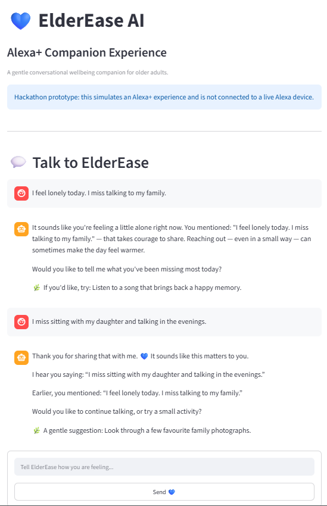
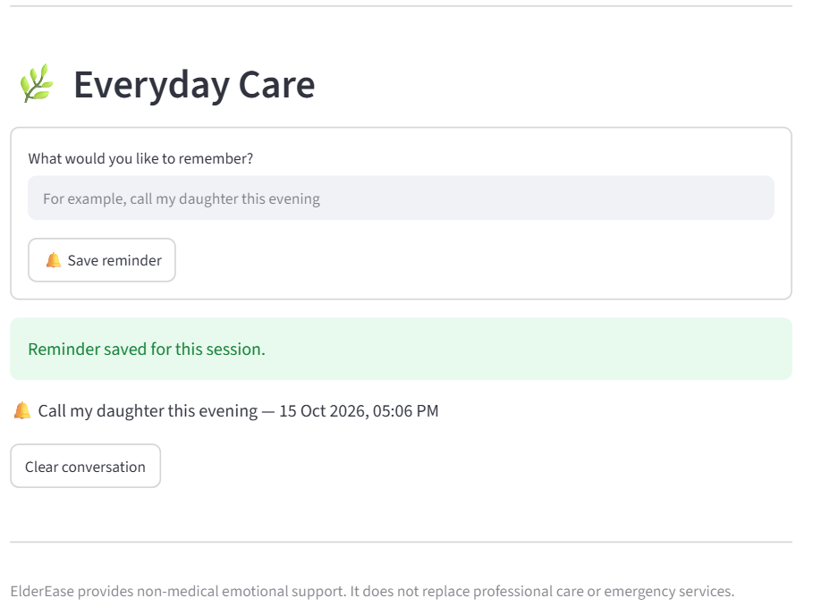

# ElderEase AI — Alexa+ Companion Experience

**A gentle, safety-aware emotional wellbeing companion for older adults.**

ElderEase AI helps older adults express their feelings, receive supportive responses, explore meaningful activities, and manage simple everyday reminders.

The Amazon hackathon edition introduces a **simulated Alexa+ companion experience** through a Streamlit web application, demonstrating contextual follow-up conversations, safety-aware responses, and everyday care.

> **Important:** This is a hackathon prototype that simulates an Alexa+ experience. It is not connected to a live Alexa device or Alexa+ service.

## 🌱 The Problem

Older adults can experience loneliness, sadness, and social isolation. Many digital tools are difficult to navigate or lack the warmth and simplicity needed for everyday emotional support.

ElderEase AI aims to make expressing feelings and accessing gentle support simpler through an accessible, easy-to-use interface.

**Target users:** Older adults who want a simple way to express how they feel and receive non-medical emotional support.

## 💡 The Solution

ElderEase AI provides a simple flow:

**Express → Understand → Support → Suggest → Remember**

- **Express:** Share feelings using everyday language.
- **Understand:** Identify a likely mood using rule-based detection.
- **Support:** Receive a compassionate response.
- **Suggest:** Explore a gentle activity.
- **Remember:** Review session-based mood information and everyday reminders.

## ✨ Key Features

- **Emotional check-ins:** Share feelings through a simple interface.
- **Contextual conversations:** Follow-up responses acknowledge previous messages.
- **Mood detection:** Rule-based identification of supported mood categories.
- **Activity suggestions:** Gentle activities relevant to the conversation.
- **Safety-aware responses:** Configured distress phrases trigger a dedicated safety response.
- **Everyday Care reminders:** Add and view simple reminders during the current session.
- **Accessible design:** Readable text, plain language, and straightforward navigation.

## 🗂️ Project Structure

```text
ElderEase-AI-AlexaPlus/
├── app.py
├── mood_engine.py
├── activity_engine.py
├── pages/
│   └── 2_Alexa_Plus.py
├── tests/
│   ├── test_mood_engine.py
│   └── test_activity_engine.py
├── docs/
│   ├── PRODUCT_VISION.md
│   ├── ARCHITECTURE.md
│   └── CHANGELOG.md
├── requirements.txt
├── .gitignore
├── LICENSE
└── README.md
```

*This is the intended structure. Confirm each file exists in the Amazon repository before publishing this tree.*

## 🛠️ Technology Stack

| Component | Technology |
|---|---|
| Application interface | Python, Streamlit |
| Mood detection | Rule-based keyword matching |
| Safety detection | Configured distress-phrase screening |
| Support responses | Template-based responses |
| Activity suggestions | Python |
| Automated testing | pytest, pytest-cov |
| Version control | Git and GitHub |

## ⚙️ Installation and Setup

**Prerequisites:** Python installed on your computer and Git for cloning the repository.

```bash
git clone https://github.com/DivyaMeghana09/ElderEase-AI-AlexaPlus.git
cd ElderEase-AI-AlexaPlus

python -m venv .venv
```

On Windows:

```powershell
.venv\Scripts\Activate.ps1
```

Install dependencies and launch the app:

```bash
pip install -r requirements.txt
streamlit run app.py
```

Open the local URL shown in your terminal. Use Streamlit's navigation to open the **Alexa+ Experience** page.

## 🧪 Testing

Run the available automated tests:

```bash
python -m pytest tests/ -v --cov=mood_engine --cov=activity_engine --cov-report=term-missing
```

Add verified test results and coverage here after running this command in the Amazon project copy.

## Screenshots

### Alexa+ Companion Experience


### Everyday Care Reminders


## 🔐 Safety, Privacy, and Limitations

- ElderEase AI provides non-medical emotional support; it is not a therapist, medical service, or emergency service.
- Mood detection relies on configured rules and may not recognise every expression of distress.
- Safety phrase matching cannot guarantee detection of all crisis situations.
- Conversation history and reminders are session-based and may be lost when the session resets.
- Everyday Care reminders do not trigger real alarms or notifications.
- This prototype simulates an Alexa+ experience and does not establish a live Alexa integration.

For mental health support in India, Tele-MANAS is available at **14416**.

## 🚀 Amazon Hackathon Edition

This edition builds on the original ElderEase AI project by introducing a separate simulated Alexa+ companion page, contextual follow-up conversations, and session-based everyday reminders.

The changes made specifically for this edition, along with testing evidence, are documented in [`docs/CHANGELOG.md`](docs/CHANGELOG.md).

## 📋 Disclaimer

ElderEase AI is an experimental wellbeing prototype intended to demonstrate accessible conversational support. It does not diagnose conditions, replace professional care, or guarantee crisis detection.

## Future Improvements

ElderEase AI is currently a Streamlit-based hackathon prototype that simulates an Alexa+ companion experience. It is not connected to a live Alexa device.

Planned improvements include:

- **Alexa Skill Integration:** Develop a custom Alexa skill to support voice-based interactions.
- **Persistent Reminders:** Store reminders so they remain available across sessions.
- **Privacy and Security:** Strengthen data protection and user privacy controls.
- **Accessibility:** Continue improving readability and ease of use for older adults.
- **Reliability:** Expand automated testing to cover interface behavior and deployment scenarios.

These are future development goals and are not implemented features of the current prototype.
